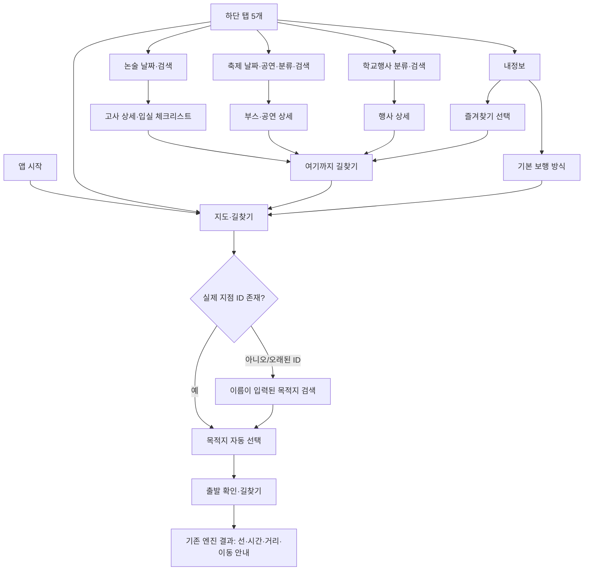

# CAMPO A-1 화면 목록·와이어프레임·버튼 흐름

기준: 최종 기획안 3~5·7장, 역할 가이드 A-1~A-4, A 상세 가이드 3~8장, 현재 `docs/FRONTEND_HANDOFF.md`와 계약. 첨부 문서는 비교 자료이며, 문서의 PR·배포 지시는 실행하지 않습니다. 이번 범위는 한양대 서울캠퍼스 최종 사용자 앱이며 PC 편집기(A-5)는 제외합니다.

## 화면 목록

| 탭 | 화면/영역 | 들어가는 방법 | 돌아가는 방법 |
|---|---|---|---|
| 지도·길찾기(첫 화면) | 지도·실내외/건물/층·경로 입력·안내·GPS | 앱 시작, 하단 지도 탭, 다른 탭의 길찾기 | 다른 탭 선택 |
| 지도 | 출발/목적지 검색 모달 | 출발/도착 검색 버튼, 지도 연결 없는 콘텐츠의 길찾기 | 장소 선택, 닫기, Android 뒤로가기 |
| 지도 | 지도 선택 모드 | 지도에서 출발/도착 선택 | 지도 점/등록 지점 선택, 선택 취소, 뒤로가기 |
| 지도 | 사진 안내 | 공급 사진이 있는 경로의 사진/마커 | 기존 뷰어 닫기. 현재 사진 공급 대기 |
| 논술 | 날짜별 시험 목록·검색 | 논술 탭 | 다른 탭 |
| 논술 | 고사 상세·준비물·입실 체크리스트 | 고사장 상세 보기 | 시험 목록으로, 뒤로가기 |
| 축제 | 날짜·타임테이블·부스 검색/분류/지도 | 축제 탭 | 다른 탭 |
| 축제 | 공연 상세 펼침 | 공연 상세 보기 | 같은 버튼, 뒤로가기 |
| 축제 | 부스 상세·운영/대기·동선 | 부스 상세 보기 또는 실제 부스 핀 | 부스 목록으로, 뒤로가기 |
| 학교행사 | 다가오는/전체·분류/검색·고정 공지·기간별 목록 | 학교행사 탭 | 다른 탭 |
| 학교행사 | 장소·시간·주최·내용·원문 상세 | 행사 상세 보기 | 행사 목록으로, 뒤로가기 |
| 내정보 | 보행 프로필·즐겨찾기·권한·앱/오픈소스 정보 | 내정보 탭 | 다른 탭, 뒤로가기는 지도 |

탭 순서: **지도·길찾기 / 논술 / 축제 / 학교행사 / 내정보**. 탭을 옮겨도 입력·검색어·필터·상세·체크리스트를 유지합니다. 돌아오면 해당 상세/목록의 위쪽부터 확인할 수 있습니다. 앱 종료 후에는 설정·즐겨찾기가 초기화됩니다(가이드의 메모리 범위).

## 전체 이동 흐름



## 와이어프레임(설계도이며 실제 Android 스크린샷이 아님)

작은/일반/큰 스마트폰은 한 열로 스크롤하고, 태블릿은 같은 정보를 최대 960dp 폭으로 가운데 배치합니다. 지도 높이는 창 높이에 따라 200~440dp로 바뀝니다. 입력/동작 버튼은 좁은 화면·큰 글씨에서 세로로 배치합니다.

```text
스마트폰 320 / 390 / 430dp            태블릿 1024dp
┌─────────────────────────┐          ┌─────────────────────────────────────────┐
│ 제목 · 한양대 · 안내     │          │      가운데 콘텐츠(최대 960dp)          │
│ 실제/가상/데이터 없음    │          │  제목 / 안내                            │
│ ┌─────────────────────┐ │          │  ┌───────────────────────────────────┐  │
│ │ 캠퍼스 지도 먼저    │ │          │  │ 캠퍼스 지도(최대 높이 440dp)      │  │
│ │ 경로선·선택 마커    │ │          │  └───────────────────────────────────┘  │
│ └─────────────────────┘ │          │  출발 / 도착 / 이동 방식                 │
│ 출발 / 도착 / 이동 방식 │          │  교환·초기화 / 길찾기                    │
│ 교환·초기화 / 길찾기    │          │  실외·실내 / 건물·층 / 선택 모드         │
│ 실외·실내·건물·층      │          │  장소 목록 / 시간·거리·안내 카드          │
│ 등록 장소 / 안내 카드   │          │  GPS·사진 / 데이터 연결 상태             │
│         ↕ 스크롤        │          │              ↕ 스크롤                   │
├─────────────────────────┤          ├─────────────────────────────────────────┤
│ 지도 논술 축제 행사 내정보│          │     지도  논술  축제  학교행사  내정보    │
└─────────────────────────┘          └─────────────────────────────────────────┘

콘텐츠 탭 공통
[시연용 고지] → [날짜·분류·검색] → [목록 카드] → [상세]
상세 = 정보 + 즐겨찾기 + 여기까지 길찾기 + (논술 체크리스트/축제 동선)
내정보 = 기본 보행 방식 + 공유 즐겨찾기 + 권한 + 앱/출처/라이선스
```

## 버튼별 동작 약속

| 버튼/입력 | 실제 처리 |
|---|---|
| 하단 탭 | 선택 탭 표시·상태 유지. 지도 이탈 시 GPS 중단 |
| 출발/도착 검색 | 모달 열기 → 이름/건물/호실 검색 → 실제 지점 선택 |
| 길찾기 | 기존 `useCampusRoute`에 요청. 성공·없음·오류 결과를 그대로 표시 |
| 출발·도착 바꾸기 / 선택 초기화 | 출발/도착 교환 또는 해제, 오래된 선과 추적 상태 제거 |
| 지도에서 출발/도착 선택 / 취소 | 선택 모드 진입·종료. 실내는 등록 지점만 허용 |
| 실외/실내/건물/층 | 표시 범위 변경. 데이터 없는 실내는 사유 안내, 임의 건물 생성 안 함 |
| 현재 위치 / 안내 시작·중지 | 필요한 때 권한 요청. 거절 시 수동 유지. 실행 중 센서 중단 가능 |
| 날짜·카테고리·검색 | 실제 목록 필터. 빈 결과 안내. 여러 단어·공백·대소문자 정규화 |
| 고사/행사/부스 상세 | 해당 상세 표시, 목록으로/뒤로가기로 복귀 |
| 공연 상세 | 펼치기/접기 |
| 준비물/입실 체크 | 체크 상태 변경. 실제 경로 시간 없이 출발 시각 생성 안 함 |
| 즐겨찾기 추가·해제·삭제 | 탭 전체 공유 목록 갱신, 내정보에 즉시 반영 |
| 여기까지 길찾기 | 지도 이동 + 실제 목적지 선택 또는 이름 검색. 같은 목적지도 재전달 가능 |
| 입장/대기/퇴장 동선 | ID 쌍이 검증되면 기존 경로 요청, 없으면 검색. 실제 대기열/혼잡도인 척하지 않음 |
| 보행 프로필 | 지도 기본 방식 반영·이전 예상 시간 해제 |
| 사진 보기 | 기존 사진 뷰어 사용. 현재 실제 사진 없음 |
| 기기 앱 설정 / 오픈소스 링크 | 기기 설정 또는 외부 URL 열기, 실패 안내 |
| 개인정보 처리방침 | D의 URL 미제공을 명시해 비활성 표시(가짜 링크 아님) |
| 오류 다시 읽기/다시 열기 | 콘텐츠/지도 재조회 또는 화면 재마운트 |

모달은 닫기/뒤로가기로 종료합니다. 상세의 뒤로가기는 목록으로, 일반 탭 화면의 뒤로가기는 지도로 돌아가며 지도 첫 화면에서는 OS 기본 뒤로가기를 유지합니다. 실제 Android BackHandler·키보드 동작은 실기기 확인이 남아 있습니다.
